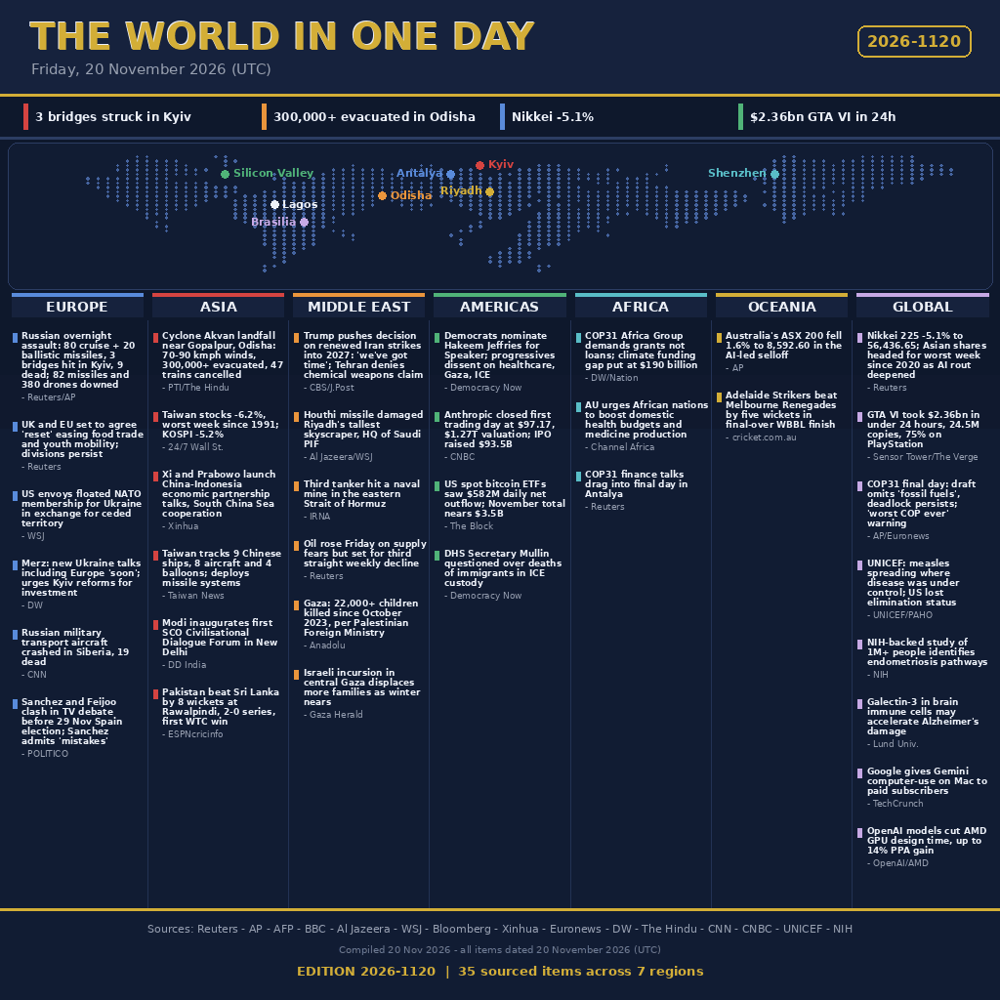

# World news poster - 20 November 2026 (v2 broadsheet)



Broadsheet-style 1024x1024 poster, deterministic (Pillow), dark navy #0D162A.

**35 sourced news items across 7 regions** (all dated 20 November 2026, UTC):

| Region | Items |
|---|---|
| EUROPE | 6 |
| ASIA | 6 |
| MIDDLE EAST | 6 |
| AMERICAS | 4 |
| AFRICA | 3 |
| OCEANIA | 2 |
| GLOBAL | 8 |

Layout: header + edition badge, 4-fact band, dot-matrix world map with 8 city markers
(Kyiv, Odisha, Riyadh, Shenzhen, Antalya, Silicon Valley, Brasilia, Lagos),
7 region columns with per-item source attribution, footer with full sources list.

## Run

```bash
python3 render.py   # generates entry.png (1024x1024, <256KB)
node main.ts        # stages entry.png + manifest.json into $MAKEFUN_OUTPUT_DIR or /output
```

Referral: a2ffxt26
